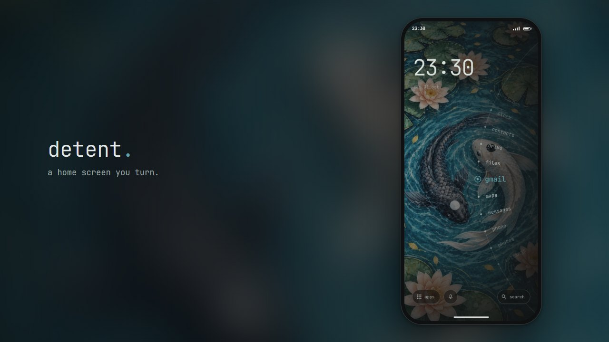
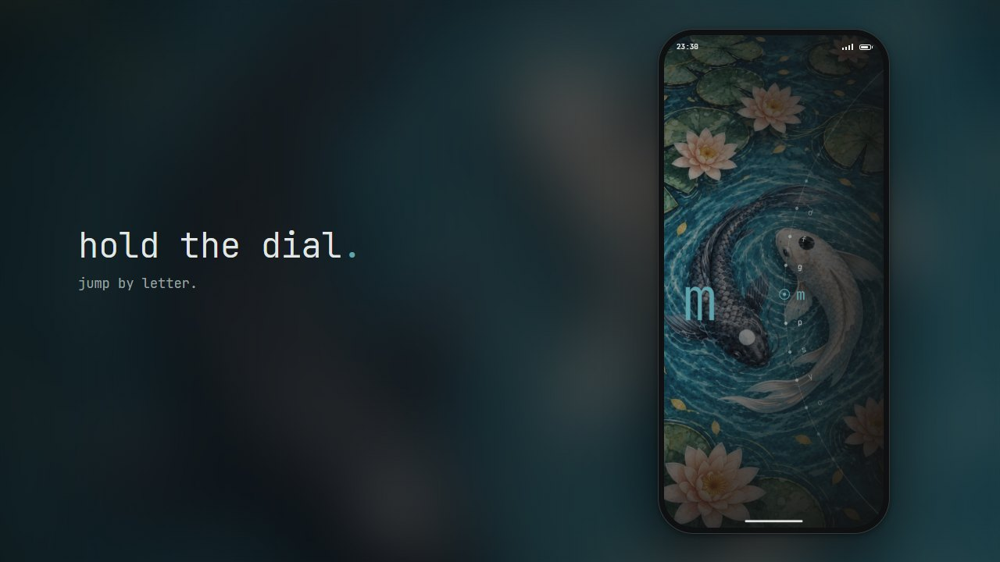
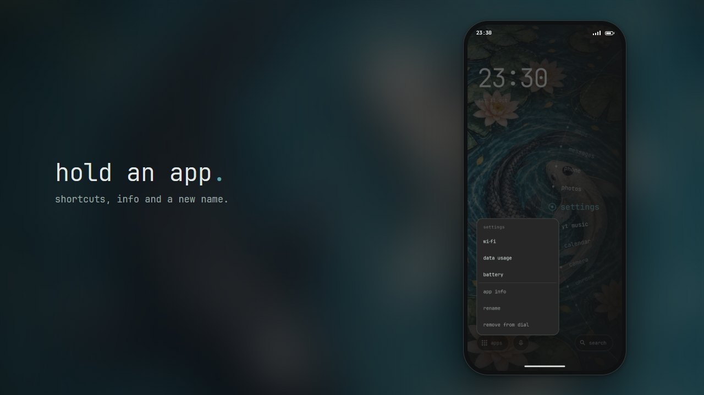
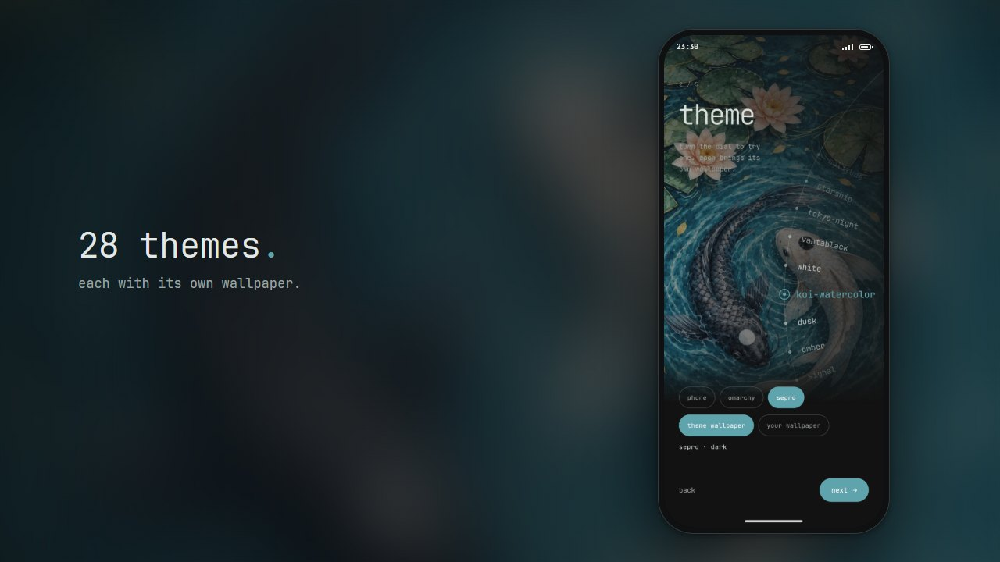
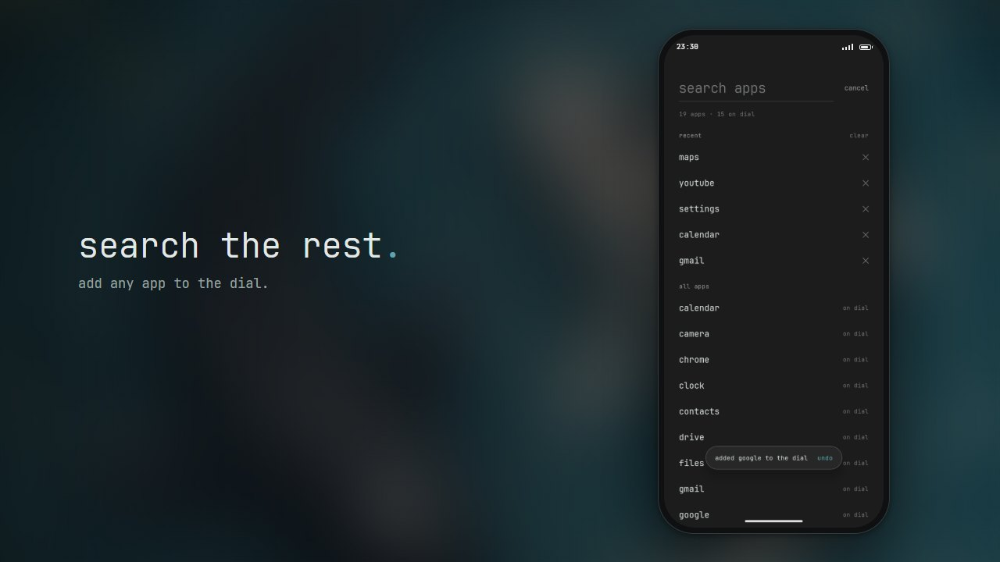
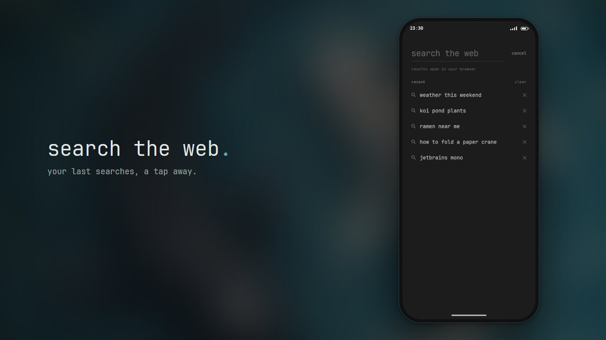
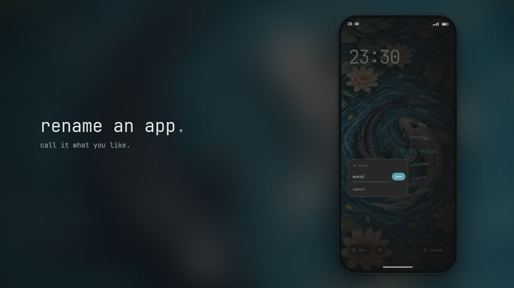
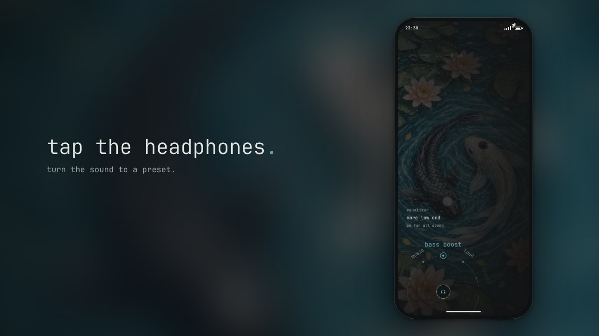
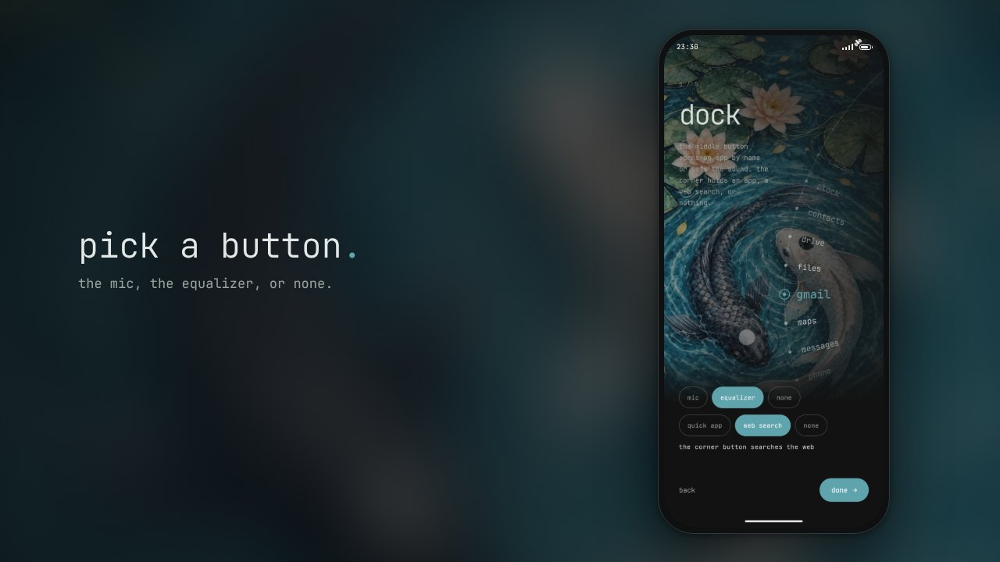

<p align="center">
  <a href="docs/media/detent-promo.mp4"></a>
</p>

# Detent

Detent is a home screen for Android that you turn. Your apps sit on a dial at the edge of the screen. Turn the dial to find an app. Tap the app to open it.

[Try the dial in your browser](https://sepro.github.io/detent/) · [Watch the 48-second video](docs/media/detent-promo.mp4) · [Download the latest APK](../../releases/latest/download/detent.apk)

## Install

You need Android 10 or later.

1. Download `detent.apk` from the [latest release](../../releases/latest).
2. Open the file on your phone.
3. If Android asks, allow your browser or file manager to install apps.
4. Open Detent and follow the setup.
5. On the `ready` step, tap `set as home app`.

To install from a computer, connect the phone with USB debugging on and run this command:

```sh
adb install detent.apk
```

## Use the dial

| Action | Result |
| --- | --- |
| Drag or flick the dial | The dial turns. Each app clicks into the notch. |
| Tap any app on the dial | The app opens. Its name lifts off the dial, and the dial turns the app into the notch. |
| Tap the dial while it turns | The dial stops. No app opens. |
| Hold the dial | Letters replace the apps. Slide to a letter and release to jump to it. |
| Hold the app in the notch | A menu shows the app shortcuts, `app info`, `rename`, and `remove from dial`. |
| Hold the clock or an empty area | The setup opens: shape, theme, apps, feel, and dock. |
| Tap `apps` | Search all your apps. The 5 apps that you last opened from search sit at the top. Tap the cross on a recent app to remove it, or tap `clear`. Tap `+ dial` to add an app to the dial. |
| Hold an app in `apps` | A menu shows `rename`, `app info`, and `add to dial` or `remove from dial`. Apps that share a name show their package below the name, so you can tell them apart. |
| Tap `rename` | Type a new name and tap `save`. The app moves to its new name's place on the dial and in search. Search still finds it by its old name. Clear the field or tap `reset to …` to get the old name back. |
| Tap the quick button | The quick app opens. If the button has no app, pick one. |
| Hold the quick button | Pick a different quick app, or tap `clear`. |
| Tap `search` in the corner | Type words and tap go. Google shows the results in your browser. Your 5 last web searches sit below the field. Tap one to search again. Tap the cross to remove it, or tap `clear`. |
| Tap the mic button and say an app name | The dial swells with your voice, and your words show at the top. When the words name one app, the dial turns to it and the app opens. If not, search opens with the words. |
| Tap the headphones button | A small dial of sound presets opens around the button. Turn it like the app dial. The preset in the notch plays as soon as the dial stops. Tap a preset to turn to it. Tap the button, the preset in the notch, or anywhere else to close the dial. |

The corner button sits in the bottom corner on the dial side. By default it is a web `search` button. On the `dock` step, you can give it one app that you need fast, such as the camera, or leave the corner empty. The middle button sits between `apps` and the corner button. By default it is the mic button. On the same step, you can make it the headphones button for the equalizer, or hide it. Without a middle button, `apps` takes the width of the corner button.

With a hardware keyboard, `j` and `k` turn the dial. `l` or `Enter` opens the app. `/` opens search. `Esc` goes back.

<p>
  
  
</p>
<p>
  
  
</p>
<p>
  
  
</p>
<p>
  
  
</p>

## Shapes and themes

Detent has 5 layouts. Each layout puts a radial dial over the wallpaper. Each name follows the curve of the dial.

| Layout | Look |
| --- | --- |
| `soft · radial · double` | Dots swell toward the notch, with a fainter inner arc. |
| `round · radial · double` | The same dots on a tighter curve. |
| `soft · radial · ticks` | Hairline ticks on a thin rim. |
| `flat · radial · dots` | A dot matrix on a wide curve. |
| `flat · radial · nodes` | The default. Small nodes on a wide curve. |

The dial can sit on the right edge (the default) or the left edge.

Detent has 28 themes. The 4 phone themes are dusk, ember, signal, and paper. They use a tinted dot-hand art. The 23 Omarchy themes each bring their own wallpaper. The sepro group holds koi-watercolor, a dark teal theme with a koi pond wallpaper. It is the default theme. On the theme step, the colours change on each click of the dial. The wallpaper loads when the dial stops.

### Use your own wallpaper

Your photo replaces the theme wallpaper. The theme still sets the colours.

1. Hold the clock to open the setup.
2. Tap `next` to go to the theme step.
3. Tap `your wallpaper` and pick a photo.
4. Turn the dial to pick the colours.
5. Tap `next` until you see `done`.
6. Tap `done`.

Detent crops the centre of the photo to the shape of your screen and keeps a copy. It does not need access to your other photos. To go back to the theme wallpaper, tap `theme wallpaper` on the same step. If the `lock screen` switch is on, the lock screen uses your photo too.

## Settings

The `feel` step has 4 switches:

| Switch | What it does |
| --- | --- |
| `sound` | Plays a short click for each app that passes the notch. The phone mutes it in silent or vibrate mode. |
| `haptics` | Gives a light tick for each app and a firmer tick for each letter. It still works when the system touch feedback is off. |
| `dots` | Shows an accent dot on apps with new notifications. The dot clears when you open the app. This switch needs notification access. |
| `lock screen` | Sets the lock screen and the system wallpaper to the theme. Android then takes the lock screen colours from it. |

The `dock` step sets the buttons at the bottom of the home screen:

| Choice | What it does |
| --- | --- |
| `mic` | The middle button opens an app by voice. This is the default. |
| `equalizer` | The middle button opens the sound dial. |
| `none` | No middle button. |
| `quick app` | The corner button opens one app. |
| `web search` | The corner button searches the web. This is the default. |
| `none` | The corner stays empty. |

The first 3 choices set the middle button, and the last 3 set the corner button.

If Android shows "Restricted setting" when you allow notification access, open the app info for Detent. Tap ⋮, then `Allow restricted settings`. Then try again.

## Equalizer

The sound dial has 7 presets:

| Preset | Sound |
| --- | --- |
| `off` | The sound as the app plays it. This is the default. |
| `voice` | Less bass and more mid range, for clearer words in podcasts and calls. |
| `clear` | More detail in the highs. |
| `music` | A little more bass and treble. |
| `bass boost` | More low end. |
| `loud` | Louder, with a limiter that holds the peaks in. |
| `night` | Softer bass, and the loud parts come closer to the quiet parts. |

While a preset is on, the headphones turn the accent colour, and a notification shows the preset with an `off` button. The first time that you close the sound dial on a preset, Android asks if Detent may show notifications. Without that permission, the equalizer still works, but the notification and its `off` button do not show. Hiding the headphones button does not turn the preset off.

Android has no way for an app to change the equalizer of the phone itself, such as Samsung Sound Quality or Dolby Atmos. Detent runs its own equalizer on top of it. This has some limits:

- Detent puts its equalizer on the sound output of the phone, so all sound goes through it. This way is old, and some phones do not allow it. On those phones, the equalizer works only in music apps that announce their sound to equalizer apps, such as many local music players. Many streaming apps, YouTube among them, do not announce their sound, so the preset does not reach them. The sound dial says so when this happens.
- Some phones play music through a direct path to the hardware that skips the equalizer, even when the phone allows it.
- The equalizer adds to the sound settings of the phone and to other equalizer apps. If another equalizer app takes control, Detent's preset has no effect until that app lets go.
- The effect lives only while Detent runs. The notification keeps Detent running, but if Android stops it anyway, the preset comes back the next time the home screen shows.

## Permissions

Detent does not have the internet permission. It does not send data anywhere.

The mic button uses the speech service of your phone, such as Speech Services by Google. That service turns your voice into text and gives Detent only the text. The service is a separate app with its own permissions.

| Permission | Why Detent needs it |
| --- | --- |
| `QUERY_ALL_PACKAGES` | To list all the apps you can open and to find your default apps for the first dial. |
| `VIBRATE` | For haptics. |
| `SET_WALLPAPER` | For the `lock screen` switch. |
| `RECORD_AUDIO` | Optional. For the mic button. The microphone is on only while Detent listens. If you do not allow it, the mic button opens the speech dialog of your phone. |
| `MODIFY_AUDIO_SETTINGS` | For the equalizer. It lets Detent put an audio effect on the sound output. |
| `FOREGROUND_SERVICE` and `FOREGROUND_SERVICE_SPECIAL_USE` | For the equalizer. They keep Detent running while a preset is on, so the preset stays on in other apps. |
| `POST_NOTIFICATIONS` | Optional. For the equalizer notification and its `off` button. |
| Notification access | Optional. For unread dots. Detent reads only which apps have notifications and when they arrived. It does not keep the notification text. |

## Build from source

You need JDK 17 or later and the Android SDK with platform 36.

To build the APK and install it on a connected phone, run these commands in the repository folder:

```sh
./gradlew assembleRelease
adb install -r app/build/outputs/apk/release/app-release.apk
```

Without the signing variables, the build uses your local debug key.

### Images

The images in `docs/media` are screenshots from an emulator in a frame. To make them again, start a 1080x2400 emulator, install the debug build, and run the script. It needs Node.js 22 or later and Chrome.

```sh
./gradlew installDebug
node tools/media/make.mjs
```

Each scene is in `tools/media/make.mjs`, and the frame is `tools/media/frame.html`. To make some of the images, name their scenes, such as `node tools/media/make.mjs search rename`. To change only the frame, add `--frame-only`, and the script uses the last screenshots without the emulator. On a slow emulator, such as one without hardware acceleration, add `--slow=8` to wait 8 times longer at each step.

## Release

The `build` workflow builds the APK on each push and pull request. You can download that APK from the workflow run.

To publish a release, push a version tag:

```sh
git tag v0.2.0
git push origin v0.2.0
```

The workflow then builds a signed APK and attaches `detent.apk` to a GitHub release.

The workflow signs releases with these repository secrets:

| Secret | Value |
| --- | --- |
| `DETENT_KEYSTORE_BASE64` | The release keystore, encoded as base64. |
| `DETENT_KEYSTORE_PASSWORD` | The keystore password. |
| `DETENT_KEY_ALIAS` | The key alias. |
| `DETENT_KEY_PASSWORD` | The key password. |

To sign a local build with the same key, set the variables `DETENT_KEYSTORE`, `DETENT_KEYSTORE_PASSWORD`, `DETENT_KEY_ALIAS`, and `DETENT_KEY_PASSWORD`. `DETENT_KEYSTORE` is the path to the keystore file.

Caution: if your phone has a build signed with a different key, Android refuses the update. Uninstall Detent first. This removes your Detent setup.

## Credits

- This project is a fork of [Detent](https://github.com/bjarneo/detent) by [bjarneo](https://github.com/bjarneo). The dial, the gestures, the layouts, the themes, and the web demo all started there. This fork has since moved away from the original, for example with the koi-watercolor theme and new defaults. Thanks to bjarneo for the original app and for sharing it under the MIT license.
- The wallpapers and the dot-hand art come from the [Omarchy](https://github.com/basecamp/omarchy) themes.
- The font is [JetBrains Mono](https://github.com/JetBrains/JetBrainsMono), under the SIL Open Font License 1.1. See [`licenses/JetBrainsMono-OFL.txt`](licenses/JetBrainsMono-OFL.txt).

## License

MIT. See [`LICENSE`](LICENSE).
